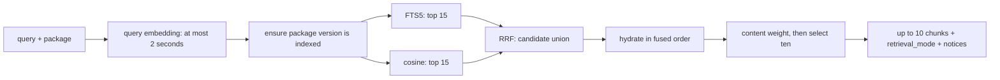

# Local Stdio MCP Server

A lightweight Elixir MCP server designed to run over `stdio` with a local SQLite database and an `AI_API_KEY`. It localises a search in the HexDocs of your favorite libraries.

## Tools

| Tool                    | Description                                                                                                                                                                                                                 |
| ----------------------- | --------------------------------------------------------------------------------------------------------------------------------------------------------------------------------------------------------------------------- |
| `search_docs`           | Search one Hex package's documentation, typespecs, guides and examples. `package` is required; ingests on demand. Results carry `hexdocs_url` and, for functions, a `source_url` pinned to the exact file, line and version |
| `get_doc` | Read a search result by `id`, with neighboring chunks from the same entry. `neighbors` defaults to 1 (0–5); continuation IDs allow reading longer entries. IDs may expire after re-ingestion. |
| `list_indexed_packages` | List indexed packages, versions, completeness, and the version this project depends on                                                                                                                                      |
| `search_hex_packages`   | Find _which_ package to use — Hex.pm names, descriptions, download counts                                                                                                                                                   |
| `search_github_issues`  | Live GitHub API search for issues and PRs in an organization (not indexed)                                                                                                                                                  |
| `remember`              | Save learnings to the local knowledge base. Takes `texts`, a list — batch a session's lessons into one call. AI assisted curation runs in the background and may merge, append to or discard what you send.                 |
| `recall`                | Search that knowledge base before re-investigating a failure                                                                                                                                                                |
| `get_token_usage`       | AI token consumption recorded locally, by model and date range                                                                                                                                                              |

The `search_docs` searches against **HexDocs**. Ask a question about an Elixir package; the tool answers from the local index, or downloads and digests the package first if it is not indexed yet. A first-time ingestion of a large package may exceed one tool call — the payload then reports progress and the job continues in the background.

> Why not just `grep deps/`? Because docs are generated from compiled modules, they show the API a macro produced — `grep` for `parse_options!/1` in `anubis_mcp` matches nothing, though it is called two lines below the `defschema` that makes it. And `grep` ranks nothing: it cannot connect "how do I avoid re-embedding" to the docs that say `chunk_overlap`.

The "package ingestion" workflow is documented in _INGESTION.md_.
The tarball chunking and persistence workflow is documented in _TARBALL_INGESTION.md_.

## Agent skill

The shareable [Hex Local skill](skills/hex-local/SKILL.md) teaches an agent when
and how to discover packages, search version-matched docs, investigate upstream
issues, and use local debugging knowledge. It includes query examples, ingestion
retry rules, and citation requirements.

After connecting the MCP server below, copy the entire `skills/hex-local` folder
to your client's skill directory. For Codex, the default personal directory is
`~/.codex/skills/`; use your configured skills location if different. The skill
supports automatic discovery or explicit invocation:

```text
Use $hex-local to check how this project's Req version handles retries.
```

The skill supplies agent instructions; it does not install or connect the MCP
server. Its optional `agents/openai.yaml` supplies Codex display metadata. Other
skill-compatible clients can use `SKILL.md` and its `references/` folder.

## Tech

- `SQLite` + FTS5 + `sqlite-vec`
- `anubis_mcp`: Compatible with Claude Code, Cursor, and Google Antigravity CLI (`agy`).
- `MDEx` for markdown (parsing and source positions — never rendering), `lazy_html` (Lexbor) for HTML extraction and per-function source links
- Cloud AI models (embeddings, chat-small, chat-large).

> [!IMPORTANT]
> Documentation search needs an embedding model. Select `AI_PROVIDER=mistral`
> or `openai` and supply `AI_API_KEY`; endpoints and models have defaults.
> `AI_PROVIDER=ollama` runs locally without an API key. Memory curation is
> optional and disabled by default; enable it with `MEMORY_ENABLED=true`.

### Which tool uses which AI provider service?

| Tool                 | Embeddings (/embeddings)                                   | Chat Model (/chat/completions)                   |
| -------------------- | ---------------------------------------------------------- | ------------------------------------------------ |
| search_docs          | Yes (embed / embed_batch)                                  | No                                               |
| search_hex_packages  | No                                                         | No                                               |
| search_github_issues | No                                                         | No                                               |
| recall               | Optional — hybrid FTS+vector with a key, FTS5 only without | No                                               |
| remember             | Yes (embed)                                                | Yes (small & large for taxonomy & deduplication) |

## Features

- **HexDocs ingestion**: fetches a package's docs tarball from Hex, extracts it in memory, and indexes it with embeddings on demand. One HTTP request per package, never a page-by-page crawl.
- **Version-aware**: with `PROJECT_ROOT` set, `latest` resolves to whatever your project's `mix.lock` pins — any age, pre-releases included — falling back to Hex's latest stable when nothing local pins the package. One version per package is kept, so results never interleave versions.
- **Hybrid search**: FTS5 and exact cosine search retrieve scoped candidates sequentially; reciprocal rank fusion returns up to ten chunks. Retrieval modes and notices expose degraded searches.
- **Curated knowledge memory**: submissions are embedded, compared to their nearest neighbours, and only then passed to a chat model that chooses `create`, `append`, `merge`, `replace`, `deprecate` or `discard`. The tool `recall` uses the same hybrid retrieval as `search_docs` — FTS5 and cosine fused by RRF — and degrades to keyword-only when no embedding is available, so it still works with no API key.
- **GitHub issues** are queried live against the GitHub API and are _not_ stored locally.

## Quickstart

### Prerequisites

- Elixir 1.20+

SQLite needs no separate install — `ecto_sqlite3` bundles it — and neither does the vector extension: `sqlite_vec` ships the binary and `config/runtime.exs` loads it with `SqliteVec.path()`.

### Setup

⚠️ Two directories are involved and mixing them up fails silently

|                  | what it is                                                                                                      |
| ---------------- | --------------------------------------------------------------------------------------------------------------- |
| **the clone**    | this repo. You build here; the resulting binary does not care where it is launched from.                        |
| **your project** | the repo you are editing. The server reads its `mix.lock` to decide which version of a package to answer about. |

**1. In the clone**:

```sh
mix deps.get
MIX_ENV=prod mix release
```

The database path is compiled in as `<the clone>/priv/mcp.db` — absolute, so it does not depend on where anything runs.

The application creates the SQLite database and its parent directories, then runs
pending migrations **before** starting MCP tools. This works from source and in
releases; no separate `mix setup` or migration command is required. A migration
failure prevents startup instead of exposing tools against an incomplete schema.
Migration logs stay off stdout so JSON-RPC remains clean.

Set `DATABASE_PATH` in the client's MCP config to select another database. Startup
prepares that path automatically. Set the same value when running maintenance
commands so they operate on the server's index. An unexpected path can still
select a different, valid database: check `list_indexed_packages.database` if docs
you expected to find are absent. `mix setup` remains an optional developer shortcut.

Rebuild with `mix release --overwrite` after changing code, then reconnect the client — a running BEAM keeps the modules it already loaded.

**2. Choose a provider**:

For hosted providers, only `AI_PROVIDER` and `AI_API_KEY` are needed for AI
configuration. Mistral remains the default when `AI_PROVIDER` is omitted.
Explicit `AI_*` endpoints and model names override presets; remove old overrides
when switching providers. Use a separate database for each embedding model, or
run `mix docs.reindex` deliberately; changing providers does not convert an index.

| Provider  | Embedding model          | Chat small / large (optional memory)            |
| --------- | ------------------------ | ----------------------------------------------- |
| `mistral` | `mistral-embed`          | `mistral-small-latest` / `mistral-large-latest` |
| `openai`  | `text-embedding-3-small` | `gpt-4o-mini` / `gpt-4o-mini`                   |
| `ollama`  | `embeddinggemma`         | `llama3.2` / `llama3.2`                         |

#### Mistral (hosted)

```sh
export AI_PROVIDER="mistral"
export AI_API_KEY="your-mistral-api-key"
export DATABASE_PATH="$PWD/priv/mcp-mistral.db"
```

#### OpenAI (hosted)

```sh
export AI_PROVIDER="openai"
export AI_API_KEY="your-openai-api-key"
export DATABASE_PATH="$PWD/priv/mcp-openai.db"
```

The OpenAI preset preserves the default 1536 dimensions of
[`text-embedding-3-small`](https://developers.openai.com/api/docs/guides/embeddings).
Its optional chat model is
[`gpt-4o-mini`](https://developers.openai.com/api/docs/models/gpt-4o-mini).

#### Ollama (local)

Install [Ollama](https://ollama.com/download) and keep its local server running.
For a CLI-only installation, run `ollama serve` in another terminal. Download
only the embedding model for documentation search:

```sh
ollama pull embeddinggemma
export AI_PROVIDER="ollama"
export DATABASE_PATH="$PWD/priv/mcp-ollama.db"
```

The preset uses `http://localhost:11434/v1` and supplies the placeholder API key
accepted by Ollama's [OpenAI-compatible API](https://docs.ollama.com/api/openai-compatibility).
It also defaults ingestion to batches of 8, one concurrent request, and a 200 ms
pause; explicit tuning overrides remain available.

#### Optional memory curation

Documentation ingestion and search do not use chat completions. `remember` is
opt-in, including for existing installations upgrading to this version:

```sh
export MEMORY_ENABLED="true"
# Ollama users also need the preset's chat model:
# ollama pull llama3.2
```

The provider supplies both chat model defaults; advanced users can override
`AI_CHAT_MODEL_SMALL` and `AI_CHAT_MODEL_LARGE`. With memory disabled, `remember` returns a disabled explanation without opening a decision or calling a provider.
`recall` continues to search existing memories, with keyword fallback if no embedding is available. Disabling memory does not delete stored entries.
Unknown providers and invalid `MEMORY_ENABLED` values fail startup clearly.

**3. Check the models, ingest a library, and search**:

For this self-test, point `PROJECT_ROOT` at the clone so versions follow its lockfile. When connecting an MCP client in step 4, use the project being edited instead. Export settings before starting IEx; `.env` files are not loaded automatically.

```sh
export PROJECT_ROOT="$PWD"
iex -S mix
```

Inside IEx, check embedding access, and chat access only if memory is enabled:

```elixir
alias StdioMcp.AI.Client

{:ok, vector} = Client.embed("Check embedding access")
IO.inspect(length(vector), label: "Embedding dimensions")

if Client.memory_enabled?() do
  for model <- Enum.uniq([Client.small_model(), Client.large_model()]) do
    IO.inspect(
      Client.chat([%{role: "user", content: "Reply with OK."}], [], model: model),
      label: model
    )
  end
end
```

Expect a nonempty vector and, when memory is enabled, `{:ok, message}` from each chat model. An HTTP 401
indicates a key/provider mismatch or invalid key; resolve that before ingestion.
These checks make provider requests; Mistral usage consumes credits. The first
local model load can take longer than later calls.

Now load `anubis_mcp` at the version in this clone's lockfile. This direct call
waits for ingestion to finish, which can take several minutes locally:

```elixir
alias StdioMcp.Docs.{Lockfile, TarballIngestion}

version = Lockfile.version("anubis_mcp")
TarballIngestion.ingest("anubis_mcp", version)
# Success: {:ok, document_count, version}
```

Only ingestion success means the docs are ready. Repeating this direct call
re-downloads and re-embeds the package. To search the stored docs through the
actual tool handler:

```elixir
{:reply, response, _} =
  StdioMcp.Tools.SearchDocs.execute(
    %{package: "anubis_mcp", version: version,
      query: "define tool schema field required execute"},
    %{}
  )

payload = response.content |> hd() |> Map.fetch!("text") |> Jason.decode!()
IO.inspect(payload["retrieval_mode"], label: "Retrieval mode")
IO.inspect(payload["notices"], label: "Notices")

payload["results"]
|> Enum.with_index(1)
|> Enum.each(fn {doc, rank} ->
  IO.puts("\n#{rank}. #{doc["signature"]}\n#{doc["hexdocs_url"]}\n#{doc["content"]}")
end)
```

Expect `"hybrid"`, an empty notices list, and version-matched passages with links.
The tool returns documentation, not a chat-generated answer. A `"keyword"` mode
means semantic retrieval degraded: read the notices. Query embedding has a
two-second budget, so a cold local model may need a warm-up and a retry.

To benchmark retrieval, exit IEx with `Ctrl+C` twice, then run in the same terminal
with the same provider and database environment:

```sh
mix docs.eval --modes fts,vector,rrf --limit 10 --verbose
```

This evaluates only packages already indexed; it does not ingest missing ones.
With just `anubis_mcp`, expect exclusions for other packages. Review exclusions
and returned passages: expectations may also name APIs that changed between
versions. A partial run is a smoke test, not a complete quality comparison.
Compare providers with the same package versions and corpus; preserve separate
databases. The benchmark uses embeddings, not chat completions, and the chat
check above verifies connectivity rather than `remember`'s curation decisions.

**4. Connect from your project**:

Install the [Hex Local skill](skills/hex-local/SKILL.md), or copy `CLAUDE.md` or
`AGENTS.md` from the clone into the repo where you want to use the server.
This is what teaches the assistant that `package` is required, that a multi-package question is several calls, and how to read `notices`. Without it the tools work but are used badly.

Copy the config file `.mcp.example.json` → `.mcp.json`.

Edit the launch path, project path, provider and API key in your project’s `.mcp.json`:

Choose `AI_PROVIDER` and supply its key for hosted providers; Ollama needs no
key. Set the absolute `DATABASE_PATH` used for evaluation. Add
`"MEMORY_ENABLED": "true"` only to enable memory curation. GUI clients may not inherit your
terminal exports, and JSON does not expand `$PWD` or `$AI_API_URL`.

```json
{
  "mcpServers": {
    "hex_local": {
      "command": "<ABSOLUTE/PATH/TO/THE/CLONE local_hex_mcp>/_build/prod/rel/stdio_mcp/bin/stdio_mcp",
      "args": ["start"],
      "env": {
        "AI_PROVIDER": "mistral",
        "AI_API_KEY": "<YOUR-API-KEY>",
        "PROJECT_ROOT": "<ABSOLUTE/PATH/TO/THE/REPO/YOU/ARE/EDITING>",

        "MCP_TRANSPORT": "stdio",
        "MCP_LOG_FILE": "<ABSOLUTE/PATH/TO/THE/CLONE local_hex_mcp>/tmp_logs.txt",
        "MCP_LOG_LEVEL": "warning"
      }
    }
  }
}
```

Antigravity reads `~/.gemini/config/mcp_config.json`, or `.agents/plugins/<name>/mcp_config.json` for a workspace plugin. Same JSON either way — copy `.mcp.example.json`.

`MCP_TRANSPORT=stdio` is required and already in the example — without it the server starts with no MCP in it (`mcp_children/0` returns `[]`).

⚠️ **Pointing `PROJECT_ROOT` at the clone is the easy mistake, and nothing reports it.** Version resolution then reads _this_ project's lockfile and answers confidently about the wrong versions.

> **One shared database is the normal case.**

`PROJECT_ROOT` is per-project:

> - each project's `.mcp.json` names its own repo
> - but they can all share the default database, and usually should
> - Only one version per package is kept, so using different repos with different version will overwrite the related documentation (if search against).

### Telemetry

The tool `get_token_usage` returns the token consumption.

The query:

```bash
get_token_usage(from: "2026-08-01", until: "2026-08-01")
```

returns a clean human-friendly Markdown

<details>

<summary>example</summary>

```json
{
  "total_requests": 12,
  "total_tokens": 10450,
  "total_prompt_tokens": 8200,
  "total_completion_tokens": 2250,
  "period": {
    "from": "2026-08-01",
    "until": "2026-08-01"
  },
  "by_model": {
    "mistral-embed": {
      "requests": 8,
      "prompt_tokens": 6500,
      "completion_tokens": 0,
      "total_tokens": 6500
    },
    "mistral-small-latest": {
      "requests": 4,
      "prompt_tokens": 1700,
      "completion_tokens": 2250,
      "total_tokens": 3950
    }
  }
}
```

</details>

## Developing on this server

Running from source has a shorter loop than rebuilding a release, so use `mix`
while you are changing the code:

```json
"command": "sh",
"args": ["-c", "cd \"$MCP_CLONE\" && exec /opt/homebrew/bin/mix mcp.server --no-compile"],
"env": {
  "MCP_CLONE": "<ABSOLUTE/PATH/TO/local_hex_mcp>",
  "MIX_ENV": "prod",
  "PATH": "/opt/homebrew/bin:/usr/local/bin:/usr/bin:/bin",
  "…": "…"
}
```

Then `MIX_ENV=prod mix compile` and reconnect, instead of `mix release
--overwrite` and reconnect.

⚠️ **Two build artifacts can disagree.** `mix compile` writes
`_build/prod/lib`, which is what `mix docs.eval` and other Mix tasks run; `mix
release` writes `_build/prod/rel`, which is what the binary serves. Verifying a
fix with `docs.eval` therefore says nothing about the running server unless you
rebuilt the release. Pick one path per session rather than mixing them.

### Ingestion tuning

Set in the `env` block of your MCP config; they take effect on a server restart, with no recompile. A malformed value falls back to the default rather than raising.

| Variable            | Default           | Notes                                                                                                                                                                                                                                |
| ------------------- | ----------------- | ------------------------------------------------------------------------------------------------------------------------------------------------------------------------------------------------------------------------------------ |
| `INGEST_TIMEOUT_MS` | `25000`           | How long a search waits for an in-flight ingestion. Must stay **below** the MCP transport's request ceiling (Anubis' session call gives up at 30s), or the request dies before the progress notice can be returned.                  |
| `EMBED_BATCH_SIZE`  | `200`; Ollama `8` | Inputs per embeddings request. The provider limits _requests_ per second, so larger batches reduce 429s. The real ceiling is tokens per request, but a token-limit rejection is bisected automatically, so this rarely needs tuning. |
| `EMBED_CONCURRENCY` | `2`; Ollama `1`   | Concurrent embedding requests. Bounded by the Finch pool and the provider's rate limit — not by CPU count; the work is IO-bound.                                                                                                     |
| `EMBED_PAUSE_MS`    | `0`; Ollama `200` | Pause after each embedding request, for providers that limit requests per second. `0` means no pacing. Raise only if 429s persist after lowering concurrency.                                                                        |

Everything else the server reads:

| Variable                                      | Default                    | Notes                                                                                                                                                                      |
| --------------------------------------------- | -------------------------- | -------------------------------------------------------------------------------------------------------------------------------------------------------------------------- |
| `AI_PROVIDER`                                 | `mistral`                  | `mistral`, `openai`, or `ollama`; supplies endpoints, models and ingestion defaults.                                                                                       |
| `AI_API_KEY`                                  | unset; `ollama` for Ollama | Required for hosted providers.                                                                                                                                             |
| `MEMORY_ENABLED`                              | `false`                    | Set `true` to enable `remember` curation. Existing `recall` remains available.                                                                                             |
| `AI_API_URL` / `AI_EMBED_URL` / `AI_CHAT_URL` | Provider endpoint          | Shared URL override; embedding/chat overrides take precedence over it.                                                                                                     |
| PROJECT_ROOT                                  | unset                      | Required. The repo being edited — **not** this clone.                                                                                                                      |
| DATABASE_PATH                                 | `<this repo>/priv/mcp.db`  | The default is absolute and compiled in. Startup creates and migrates the selected database. Set it for a separate index, and use the same value for maintenance commands. |
| `AI_EMBED_MODEL`                              | Provider preset            | Changing it invalidates the whole index; `mix docs.reindex` is the supported path.                                                                                         |
| `AI_CHAT_MODEL_SMALL` / `_LARGE`              | Provider preset            | Structuring and curation for `remember`.                                                                                                                                   |
| `GITHUB_TOKEN`                                | unset                      | Raises the rate limit for `search_github_issues`.                                                                                                                          |
| `MCP_LOG_FILE` / `MCP_LOG_LEVEL`              | unset / `warning`          | The only way to see anything: stderr is discarded by the client.                                                                                                           |

> Changing code requires `MIX_ENV=prod mix compile` **and** reconnecting the MCP server — recompiling alone does not reload modules into a running BEAM.

### Optional: Litestream replication

Replicate your SQLite database to cloud storage (S3, B2, etc.) for backup and portability.

1. Install [Litestream](https://litestream.io/install/)
2. Configure replication for `DATABASE_PATH`

## Which version do you get?

The server runs from _its own_ directory, so `:application.get_key/2` reports the dependencies of `local_hex_mcp` and never the repo you are editing.
Left at that, `latest` falls through to Hex's latest stable, which may be a different major line than your code compiles against — and nothing in the answer says so.

`PROJECT_ROOT` closes that. Point it at the repo you are working in and the server reads that project's `mix.lock` itself:

```txt
explicit version:  ->  $PROJECT_ROOT/mix.lock  ->  the server's own BEAM  ->  Hex latest stable
```

| source                   | switches the index? | notes                                                                    |
| ------------------------ | ------------------- | ------------------------------------------------------------------------ |
| `version:` argument      | yes                 | Explicit wins over everything.                                           |
| `$PROJECT_ROOT/mix.lock` | **yes**             | Authoritative for this project, and may point _backwards_.               |
| the server's own BEAM    | no — reports drift  | An accident of where the server was launched, not a statement about you. |
| Hex latest stable        | no — reports drift  | Correct when nothing local pins the package.                             |

Read fresh on every lookup, never cached, so `mix deps.get` mid-session is
picked up without restarting the server.

**The lockfile may downgrade, deliberately.** A project on `boruta 2.3.0` gets
2.3.0 docs even though `3.0.0-beta.4` exists. Refusing to move backwards would
serve documentation for code the project does not run — silently, which is worse
than the re-ingest it costs. Pre-releases are equally fine: the lockfile is a
statement of fact, not a preference to be second-guessed.

**Only one version per package is kept.** Honouring a second project's lockfile
therefore evicts the first project's docs, and the search says so:

> Replaced indexed 'nimble_options' v1.1.1 with v1.1.0, which
> /path/to/mix.lock pins. Only one version per package is kept. If two projects
> share this DATABASE_PATH they will evict each other and re-embed on every
> switch — give each project its own DATABASE_PATH and PROJECT_ROOT.

A single switch is normal — you changed projects. Repeated switching means two
projects share a database, and that is a configuration problem no retry fixes.

**Without `PROJECT_ROOT`** the old rule applies: pass `version` yourself whenever
the answer must match your lockfile, or accept Hex latest stable.

## The embedding model is part of the index

Every cosine comparison must use vectors from the **same model**. Docs use one global model record; knowledge records model provenance per row.

Two models are never comparable: different dimensions make sqlite-vec raise, and _identical_ dimensions raise nothing at all while returning noise.

`embedding_config` records the configured docs model name and the dimension read from returned vectors. From that:

- **Ingestion refuses** to write docs vectors from a different model, before downloading and again in the replacement transaction.
- **Search disables the vector arm** on a mismatch and returns a notice, instead of raising into a rescue and silently degrading to keyword-only.
- **`list_indexed_packages`** reports `index_model`, `dims`, `query_model` and `matches_config?`.

So changing `AI_EMBED_MODEL` always costs a full re-embed of every package — that is a property of embeddings, not of this storage.

`mix docs.reindex` is the supported way to do it.

### Binary vector storage

Docs and knowledge embeddings are stored as little-endian float32 BLOBs, and query
vectors are bound as binary SQL parameters. This avoids parsing JSON for each row
in a cosine scan. The embedding model, dimensions, and float32 values are unchanged.

On upgrade, the startup migration converts existing JSON vectors in place, with
no provider requests or re-embedding. It preserves document IDs, text, timestamps,
FTS content, the docs model record, and per-row knowledge provenance. Invalid
legacy vectors abort the migration transaction rather than partially converting
the index. Rollback serializes floats with full round-trip precision.

Direct `Search.search/2` and `search_detailed/2` callers can pass a float list or
the existing JSON-array query format. Schema-level embedding fields now contain
packed binaries; new writes accept numeric lists or packed binaries through
`StdioMcp.Vector`. JSON decoding is explicit through `Vector.from_json!/1`.

The [storage benchmark](priv/eval/vector_storage_results.md) compares identical
saved queries and vectors before and after conversion, including full cosine
distances and final result order. Its timings exclude the embedding API call.

## Maintenance tasks

| Task               | What it does                                                                                                                                                                          | Costs                                       |
| ------------------ | ------------------------------------------------------------------------------------------------------------------------------------------------------------------------------------- | ------------------------------------------- |
| `mix docs.drift`   | Re-derives every package's chunks from its tarball and compares to what is stored. Answers "would a refresh change anything?"                                                         | One download per package, **no embeddings** |
| `mix docs.reindex` | Re-downloads and re-embeds every indexed package under the current model. The supported way to change `AI_EMBED_MODEL`.                                                               | Full re-embed                               |
| `mix docs.sources` | Backfills `source_url` on rows indexed before that column existed.                                                                                                                    | One download per package, no embeddings     |
| `mix docs.eval`    | Retrieval benchmark over a fixed query set: `success@k`, `MRR@10`, `success@10`, per arm. `--show N` prints the documents each query actually returned.                               | One embedding per query                     |
| `mix docs.judge`   | Writes `priv/eval/judgements.md` — what the server returned, for a human to mark relevant or not. `mix docs.eval --judged` then scores precision rather than a single guessed target. | One embedding per query                     |

The reflex after changing the chunker is to re-index everything. `mix docs.drift`
is the cheap check that usually says you do not have to.

## Knowledge curation

`remember` does not simply append. Each submission is embedded, compared against
its nearest stored neighbours, and — when one is close enough to be worth
thinking about — passed to a chat model that decides what to do with it.

| Action        | When                                     | What happens                        |
| ------------- | ---------------------------------------- | ----------------------------------- |
| **create**    | No similar neighbors (similarity < 0.8)  | New entry                           |
| **discard**   | Too similar (> 0.9), no additional value | Do nothing                          |
| **append**    | Similar neighbor, new info adds value    | Concatenate to existing content     |
| **merge**     | Overlapping but complementary info       | Synthesize old + new into one entry |
| **replace**   | Old info is factually wrong/superseded   | Replace content of existing entry   |
| **deprecate** | Neighbor is outdated by new info         | Mark old as `outdated=true`         |

Two thresholds govern it. Below `@similarity_threshold` (0.8) nothing reaches the
LLM: the entry is created directly and flagged `curated: false`, which is what
makes the floor auditable rather than a guess. Above `@duplicate_threshold` (0.9)
a submission carrying no new fact is discarded.

The floor was 0.7 and that was too low to mean anything. Measured over 91 pairs
of _known-distinct_ entries: median similarity 0.738, maximum 0.943, and 73%
cleared 0.70 — so the gate fired on three quarters of all pairs, none of them
duplicates, and every submission reached the large model. Cosine similarity on
prose measures topic, and a knowledge base that is all "Elixir debugging
findings" is one topic. At 0.80 that drops to 19%.

It errs low on purpose. A threshold set too low costs one model call and the LLM
then correctly answers `create`; set too high, a real duplicate never reaches the
LLM and is stored forever. Cheap and self-correcting beats permanent.

Curation is asynchronous — `remember` returns a `request_id` per entry in
milliseconds and the work happens in a background task, in order. `texts` takes a
list precisely so a session's worth of lessons is one call: repeated calls buy no
parallelism (an Anubis session holds one request in flight) and firing several
concurrently is a reliable way to collect 429s.

## Search engine

A warm search embeds the query, retrieves package-scoped candidates sequentially
from FTS5 and exact cosine search, then combines their ranks with reciprocal rank
fusion (RRF) and a content weight. There is no learned reranker. SQLite scans the scoped stored vectors;
this is exact search, not an approximate nearest-neighbour index.



Both retrieval arms apply package, version and examples filters **before** their
limit. The FTS tokenizer preserves `_` and `/`; query expansion searches both
whole identifiers and their component words. RRF adds `1 / (60 + rank)` per arm.
Agreement between arms is rewarded, but an item found by only one can survive.
Before selecting the final ten chunks, prose queries apply a soft content weight:
heading-only entries, descriptions that merely repeat their title, and bare
typespecs receive 40% of their RRF score. Explanations and code examples keep their
full score. Weighting the entire candidate union lets useful single-arm hits
displace stubs before the cutoff. Identifier queries retain ordinary RRF ordering.
All documents remain indexed; this needs no re-embedding or chat-model call.

### Chunking and ingestion

Documentation is downloaded as an in-memory tarball. Markdown is split at
headings, blocks and list items, with a byte splitter for oversized blocks.
Heading breadcrumbs and option names distinguish sibling chunks. Navigation-only
sections are excluded, and structural chunks do not overlap.

Embedding batches run with bounded concurrency. Failed embedding aborts ingestion
before replacement. Document rows, the embedding model record and FTS updates
commit in one transaction. Existing docs remain intact if that transaction fails.
Only one version per package is kept; shared databases can require re-ingestion
when projects pin different versions of the same package.

Ingestion runs under a supervisor independently of the foreground request. A
retry without `refresh: true` joins an ingestion already running for that version.

### Deadlines and degradation

The `search_docs` tool sets a **27-second foreground budget**, leaving headroom
under the documented 30-second transport ceiling. Query embedding gets at most
2 seconds. The ingestion wait is capped by `INGEST_TIMEOUT_MS` and the remaining
request budget, reserving time to return results or a progress notice. An outer
deadline also bounds version lookup and database retrieval. A request queued
behind another request may still encounter the transport's own timeout.

| Condition                                           | Behaviour                                               |
| --------------------------------------------------- | ------------------------------------------------------- |
| Query embedding fails, times out, or has no API key | Keyword retrieval with a notice                         |
| Docs index model differs from query model           | Keyword retrieval with a model-mismatch notice          |
| One retrieval arm raises                            | The other arm still runs; a notice names the failed arm |
| Healthy arms find no matches                        | Empty results, with the attempted retrieval mode        |
| Ingestion exceeds its wait budget                   | Progress notice; ingestion continues                    |
| Other foreground work exceeds the request budget    | Deadline notice; any supervised ingestion continues     |

`retrieval_mode` is `hybrid`, `keyword`, `vector`, or `none`. It describes which
arms ran successfully, not whether their results were relevant. Notices explain
fallbacks. Direct Elixir callers can use `Search.search_detailed/2` for the same
metadata; `Search.search/2` retains its `{results, notices}` interface.

Search responses also include structured ingestion and version metadata:

| Field | Meaning |
| --- | --- |
| `index_status` | `ready` (complete embeddings), `incomplete` (missing embeddings with no repair performed), `indexing` (ingestion still running), `error` (resolution or ingestion failed), `not_checked` (invalid options or missing package), or `unknown` (foreground deadline expired). This describes indexing, independently of retrieval success. |
| `ingested_this_request` | `true` when this request observed successful ingestion, including a job it joined; `false` for cache hits, pending jobs, or reported failures. `null` after a foreground deadline because completion is unknown. It does not claim this request started the job. |
| `resolved_version` | Selected version, including cached versions and targets still indexing or whose ingestion failed; `null` if resolution failed or is unknown. Result rows retain their actual indexed versions, which can differ when an old index survives a pending or failed refresh. |
| `version_source` | `explicit`, `project_lock`, `server_app`, `server_elixir`, or `hex_latest` identifies the authority selecting the version. `cache` means an unpinned indexed version was retained, even when Hex reports a different release. `null` when no version was resolved. |
| `elapsed_ms` | Monotonic elapsed time for this tool execution, including query embedding. Direct `Search.search_detailed/2` calls measure search only. |

Use the optional `doc_category` search argument to focus the evidence:

| Value | Entries searched |
| --- | --- |
| `all` (default) | All documentation, preserving existing behavior. |
| `guides` | ExDoc `extras`, excluding recognized changelog pages. Migration guides remain guides. |
| `api` | Non-`extras` entries, including modules, functions, macros, callbacks, types, and other published API kinds. |
| `changelogs` | ExDoc `extras` whose page identifier is `changelog`, `changes`, `history`, `release_notes`, `release-notes`, or `releasenotes`, case insensitive, including nested paths. |

For example, `search_docs(package: "oban", query: "unique jobs", doc_category: "guides")`
searches guides; change the category to `api` for API entries. Direct Elixir callers
can pass the same option to `Search.search/2` or `Search.search_detailed/2`.
The filter applies before both retrieval arms rank candidates and combines with
`include_examples_only`. It requires no re-ingestion. Changelog detection uses
page names rather than prose; unusually named changelogs remain under `guides`.
Invalid categories return a validation notice without running search or ingestion.

Knowledge vectors carry their own `embedding_model` on each row. Legacy vectors
with unknown provenance and vectors from other models are excluded from cosine
retrieval and curation neighbours, while their text remains keyword-searchable.
`mix docs.reindex` rebuilds them; failure leaves the old provenance unchanged.

### Evaluation

```sh
mix docs.eval --limit 10 --candidates 15 --pool 10 --verbose
mix docs.judge --depth 10
mix docs.eval --judged --limit 10
mix docs.eval --suite holdout --limit 10
```

The benchmark separates per-arm depth, fused-pool size and output cutoff. Defaults
are 15, 10 and 5 respectively. The RRF pool therefore matches production, and
`success@10` measures whether at least one expected chunk occurs in the first ten
results. `success@k` is query success, not recall over all relevant documents.
`MRR@10` describes first-hit ordering. Retrieval timings **exclude** query
embedding, version lookup and ingestion; query embedding latency is reported
separately. Vector evaluation refuses unverified or mismatched model provenance.

Human judgements are keyed on package, URL and exact chunk-content hash. Sibling
chunks sharing a URL are judged separately. Unchanged chunks retain marks across
re-ingestion; changed chunks and legacy page-level marks require review. Judged
precision reports its coverage, since partially labelled results do not establish
precision over the entire output.

The existing query set is a regression suite used repeatedly during tuning, not
a held-out estimate of generalization. Corpus statistics affect BM25 across
packages. Record the corpus, models and parameters with each result, and evaluate
new queries before changing ranking. `--suite holdout` selects six new questions
that were not used in the historical tuning; validate their expectations before
treating their scores as evidence, and reserve fresh questions once tuning uses them. Historical measurements and reranker
experiments are preserved in `Notes.md`; they are not current performance claims.

The earlier reranker did not improve the measured top-five success rate enough
to justify its dependencies and startup cost. That supports leaving it out now;
a wider candidate pool or a different corpus would warrant a new experiment.

## Worked examples

Both of these are real questions from a session where the answer was genuinely
unknown, and both are now regression queries in `mix docs.eval`. You do not call
the tool yourself — you ask a normal question and the assistant decomposes it.

### A question with no answer in your training data

```txt
can an MCP server ask the client's LLM to run a completion, and does
anubis support it?
```

The assistant issues one call, using the vocabulary the package's own docs would
use rather than the words in the question:

```elixir
search_docs(package: "anubis_mcp",
            query: "server requests a completion from the client model, sampling create message")
```

It returns `Anubis.Server.send_sampling_request/2` (server side),
`Anubis.Client.register_sampling_callback/2` (client side), the guide section
that explains sampling alongside roots and elicitation, and the callback's return
shape — with a citable `hexdocs_url` on each.

### A question whose answer shares no words with it

```txt
how do I check the client declared a capability before sending it a request?
```

```elixir
search_docs(package: "anubis_mcp",
            query: "check whether the connected client declared a capability before sending a server request")
```

Rank 2 is `Anubis.Server.send_elicitation_request/3`, whose docstring happens to
carry the rule for _all three_ server-initiated request kinds:

> The client must advertise the `elicitation` capability or the call returns
> `{:error, :capability_not_supported}` after enqueueing.

Nothing in the query lexically matches that function — no shared identifier, no
shared phrasing. That is the vector arm doing the one thing BM25 structurally
cannot, and it is the case the whole hybrid pipeline exists for.

### What it does not tell you

Both answers above are correct. Extrapolating from them was not: the docs say
`roots` is supported and Claude Code advertises it, so sending a `roots/list`
request looks safe — and it deadlocks the stdio transport in anubis_mcp 1.14.0,
because `ServerRequests.send_to_transport/3` calls back into a transport already
blocked on the session.

`search_docs` tells you what a library **says**, reliably and with a citation. It
cannot tell you what it **does** under your transport, at your concurrency, in
your session. Interactions between processes are in no docstring.

### One call at a time

An Anubis session holds one MCP request in flight and queues the rest
(`Session.Scheduler.enqueue_or_dispatch/5` dispatches only when `in_flight` is
`nil`). Tool calls are therefore serialised, and issuing several in parallel buys
nothing.

It costs something, though: the transport's `GenServer.call(session, …, 30_000)`
starts its clock when the request is _sent_, not when it is dispatched, so a slow
request burns the budget of everything queued behind it. A 25s ingest leaves a
queued search roughly 5s before its own transport call times out. This is the
main reason `INGEST_TIMEOUT_MS` sits below the transport ceiling rather than at
it.

For tools called repeatedly in one turn — `remember` especially — take an array
and iterate inside a single call rather than relying on parallel invocations that
cannot happen.

### Multi-package questions

A search is scoped to **one** package, so a question spanning several becomes
several calls, each written in that package's own vocabulary:

```elixir
search_docs(package: "anubis_mcp", version: "1.14.0",
            query: "StreamableHTTP Plug router forward authorization")

search_docs(package: "boruta", version: "3.0.0-beta.4",
            query: "authorize access token bearer Plug protect resource")
```

Sending the same sentence to both matches neither well. Any package not already
indexed is downloaded, chunked and embedded first.

## Local embeddings

`AI_API_URL` addresses both `/embeddings` and `/chat/completions`, which assumes one provider serves both.

An embedding-only server has no chat route. Keep memory disabled for search-only
usage. If enabling `MEMORY_ENABLED=true`, configure a working chat endpoint too.
`AI_EMBED_URL` and `AI_CHAT_URL` override the shared value independently; both default to it, so a single provider still needs no extra configuration.

[`text-embeddings-inference`](https://huggingface.co/docs/text-embeddings-inference) is in homebrew-core and exposes an OpenAI-compatible `/v1/embeddings`:

```bash
brew install text-embeddings-inference     # formula name
text-embeddings-router --model-id Qwen/Qwen3-Embedding-0.6B --port 8081
```

The binary is `text-embeddings-router`, not the formula name. First run downloads
the weights and does a warmup pass, both slow and both one-time.

```json
"AI_EMBED_URL": "http://localhost:8081/v1",
"AI_EMBED_MODEL": "Qwen/Qwen3-Embedding-0.6B",
"AI_API_KEY": "-",
"EMBED_BATCH_SIZE": "32",
"EMBED_CONCURRENCY": "1",
"EMBED_PAUSE_MS": "0"
```

**`EMBED_BATCH_SIZE` must not exceed TEI's `max_client_batch_size`** (32 by
default, printed at startup). Oversized batches are rejected, and the automatic
bisection will not rescue them: `token_overflow?/1` recognises the _provider's_
token-limit shape, and a client-batch-size rejection is a different error, so the
ingest aborts instead of halving. Match the two numbers.

`AI_API_KEY` only has to be non-empty; it is sent as a bearer token the local
server ignores. With memory enabled, chat goes to `AI_CHAT_URL` (or the shared
provider URL), which must support the configured chat models. `recall` uses the
embedding endpoint and remains available with memory curation disabled.

Three things to expect:

- **Switching embedders costs a full re-index**, and is refused until you run
  one. `embedding_config` compares the _model name_, not the dimension, which
  matters here: Qwen3-Embedding-0.6B is 1024-dim exactly like `mistral-embed`, so
  nothing would raise and cosine would simply return noise. `mix docs.reindex` is
  the supported path.
- **The first ingest of a large package will not finish inside one tool call.**
  That is the designed path, not a failure: the payload carries a
  "still being indexed" notice, the job keeps running, and calling `search_docs`
  again attaches to it. Drop `refresh: true` from the retry.
- **Lower `EMBED_CONCURRENCY`, do not raise it, and do _not_ set
  `EMBED_PAUSE_MS` to zero.** Against a hosted provider the work is IO-bound and
  concurrency hides latency; against a local server the server _is_ the
  bottleneck, so parallel requests only contend. `1` is the sensible value.

  The pause is the subtler one. There is no rate limit to pace against, but TEI
  processes sequentially on CPU whatever `max_concurrent_requests` claims, so
  **during an ingest every search's query embedding queues behind the ingest
  batches**. Measured on an M-series CPU with Qwen3-Embedding-0.6B: a 32-document
  batch takes 8-17s of inference, and a query issued behind one waited 8.4s,
  12.8s and 17.4s in `queue_time` for 48ms of its own compute. Long enough to
  exceed the MCP transport's 30s ceiling. `EMBED_PAUSE_MS` around `200` yields
  slots between batches so interactive searches get through; against a hosted
  provider, where requests genuinely run in parallel, `0` remains right.

Measured throughput on an M-series CPU (no Metal in the homebrew bottle):
**~244 tokens/s**, so a 32-document batch is 8-17s and a full 3967-chunk reindex
runs 25-30 minutes. That is a one-off, and it is the ingest side. **A single
query embedding is ~48ms of inference**, comparable to a round trip to a hosted
provider — search latency is not the thing to worry about here, contention is.

Whether it is any _good_ is measurable rather than arguable, and this is the
argument for trying it: re-embedding locally is free, so `mix docs.eval` can
compare embedders the way it compared retrieval strategies. The vector arm carries
conceptual retrieval (concept recall 0.94 against FTS's 0.88) and concept MRR at
0.65 is the weakest number in the table — the one axis never yet swept, because
until now every attempt cost API spend.

## Appendix: example model choices

Any provider exposing OpenAI-compatible `/embeddings` and `/chat/completions`
works; set `AI_API_URL` and the three model names. Prices drift — treat these as
a shape, not a quote.

| Model           | Mistral / cost            | OpenAI /cost                  | Gemini /cost                       |
| --------------- | ------------------------- | ----------------------------- | ---------------------------------- |
| Embeddings      | mistral-embed 0.1 /M      | txt-embedding-3-small 0.02 /M | text-embedding-004 0.025 /M        |
| Fast extraction | mistral-small-4 0.15/0.60 | GPT-5-nano 0.05,0.40 /M       | gemini-2.5-flash-lite 0.10,0.40 /M |
| Classification  | mistral-large-3 0.50/1.50 | GPT-5-mini 0.25,2.00 /M       | gemini-3.1-flash-lite 0.25,1.50 /M |

## Regression tests

Run `mix test --no-start`. The test helper starts the app against a disposable
SQLite database, verifies automatic startup migrations, and uses a local fake embedding provider. It does
not use your index or API key.

After upgrading an existing installation, rebuild and reconnect. Startup applies
pending migrations to the configured `DATABASE_PATH` before serving requests.
The tokenizer migration rebuilds FTS without re-embedding docs. Legacy knowledge
vectors require `mix docs.reindex` before semantic recall can use them; their text
remains searchable throughout.
